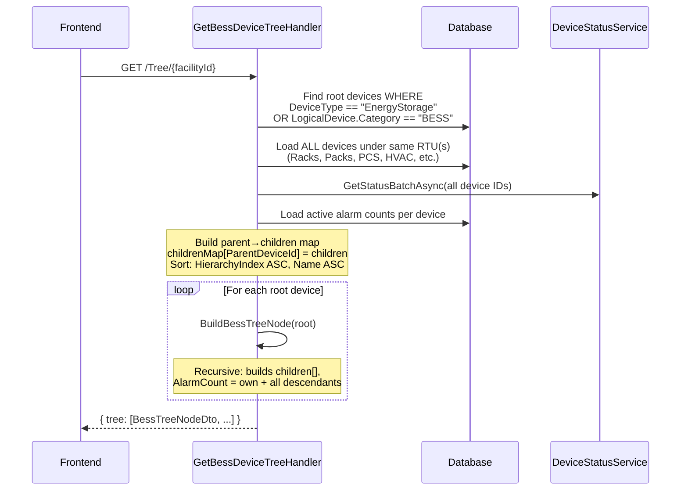
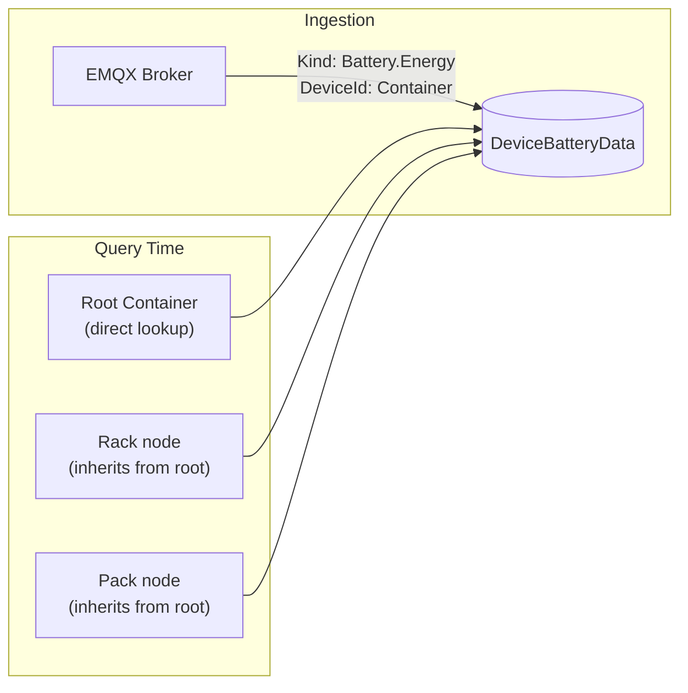
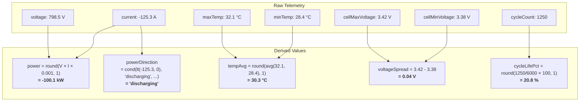
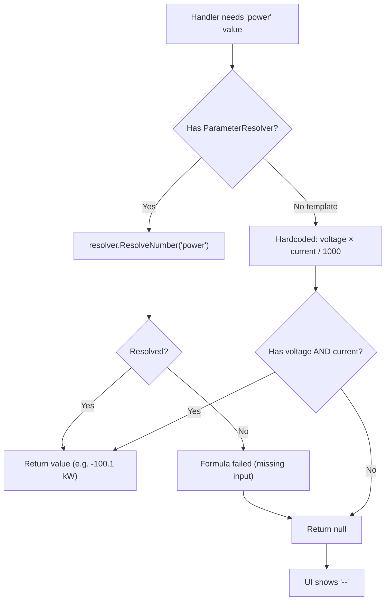
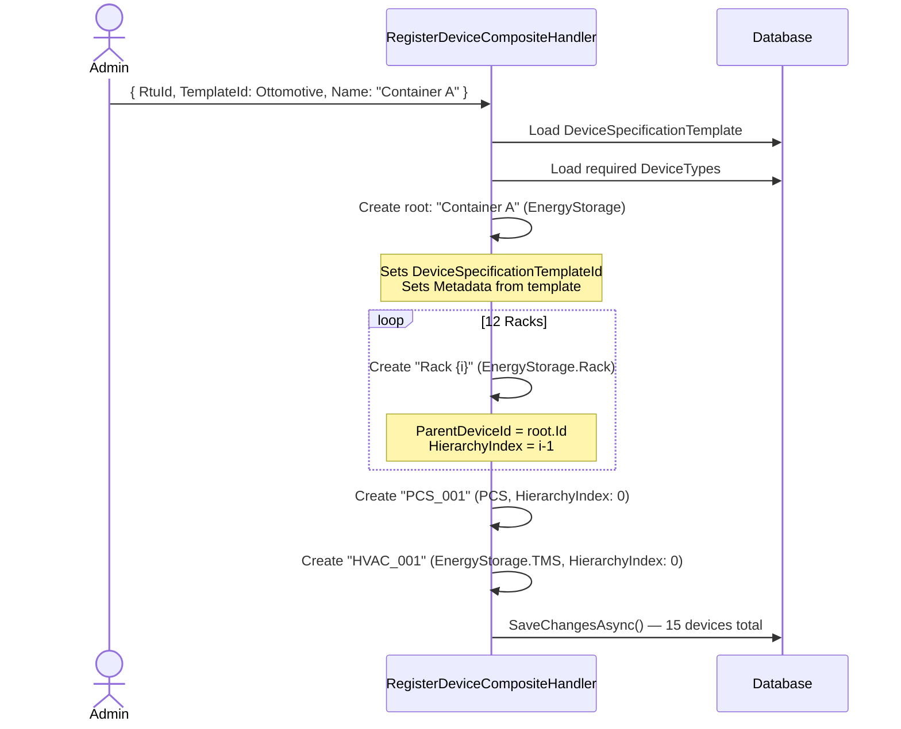

# BESS Hierarchy — Backend Analysis & Documentation

## 1. What the User Sees

When a user navigates to **Battery > Battery Package > Hierarchy tab**, the frontend calls:

```
GET /api/v1/BatteryStorage/Tree/{facilityId}    → full device tree
GET /api/v1/BatteryStorage/Units/{unitId}/Header → level-aware header on node click
GET /api/v1/BatteryStorage/Units/{unitId}/{tab}  → tab content (summary, health, etc.)
```

---

## 2. Physical Hierarchy — Ottomotive Reference Cabinet

The **Ottomotive BESS Container** is the reference device. The `DeviceSpecificationTemplate.HierarchyTemplate` defines:

```
Ottomotive BESS Container (DeviceType: EnergyStorage)
  ├── Rack 1   (EnergyStorage.Rack,  HierarchyIndex: 0)
  ├── Rack 2   (EnergyStorage.Rack,  HierarchyIndex: 1)
  ├── ...
  ├── Rack 12  (EnergyStorage.Rack,  HierarchyIndex: 11)
  ├── PCS_001  (PCS,                 HierarchyIndex: 0)
  └── HVAC_001 (EnergyStorage.TMS,   HierarchyIndex: 0)
```

**Seed JSON** (`ApplicationDbContextInitializer.cs`):
```json
{
  "children": [
    { "key": "rack",  "deviceTypeName": "EnergyStorage.Rack", "count": 12, "namePattern": "Rack {index}" },
    { "key": "pcs",   "deviceTypeName": "Pcs",                "count": 1,  "namePattern": "PCS_001" },
    { "key": "hvac",  "deviceTypeName": "EnergyStorage.TMS",  "count": 1,  "namePattern": "HVAC_001" }
  ]
}
```

### Ottomotive Metadata (Reference Specs)

| Property | Value |
|----------|-------|
| Rated Capacity | 3000 kWh |
| Rated Power | 1500 kW |
| Nominal Voltage | 800 V |
| Cell Chemistry | LFP |
| Rack Count | 12 |
| Cells Total | 244 |
| Cells Per Rack | 20 |
| Designed Cycle Life | 6000 |

---

## 3. Deeper Hierarchy — LogicalDevice Model (IEC 61850)

The `LogicalDevice` seed data defines a deeper nesting that **supports Rack → Pack → Module** levels:

```
BatteryContainer (LogicalDevice, Category: BESS)
  └── BatteryRack ×4 (EnergyStorage.Rack)
        └── BatteryPack ×8 (EnergyStorage.Pack)
              └── (leaf — no further children defined)
```

**Key difference:**
- **Ottomotive template** (via `RegisterDeviceComposite`): Only creates Racks + PCS + HVAC (1 level deep)
- **LogicalDevice model** (via `RegisterDeviceFromLogicalDevice`): Creates Racks → Packs (2 levels deep, extensible to Modules)

---

## 4. All Device Type Levels

```
DeviceTypeNames (src/Domain/Constants/DeviceTypeNames.cs)
│
├── EnergyStorage              → display: "unit"     Root container
├── EnergyStorage.Rack         → display: "rack"     Rack within container
├── EnergyStorage.Pack         → display: "pack"     Pack within rack
├── EnergyStorage.Module       → display: "module"   Module within pack
├── EnergyStorage.Battery      → display: "battery"  Individual cell/battery
├── EnergyStorage.Controller   → display: "esc"      Energy Storage Controller
├── EnergyStorage.TMS          → display: "hvac"     Thermal Management System
├── PCS                        → display: "pcs"      Power Conversion System
├── Solar                      → display: "solar"    Solar panel
└── Smart Meter                → display: "meter"    Grid meter
```

### Display Type Mapping

The `BessDisplayTypeMapper` (`GetBessDeviceTree.cs:120-136`) converts DeviceType names to frontend display types. **Any unknown DeviceType returns `null` and is filtered out of the tree.**

---

## 5. How the Tree is Built

### Sequence Diagram



### Algorithm (`GetBessDeviceTree.cs`)

1. **Find roots:** Query devices where `DeviceType.Name == "EnergyStorage"` OR `LogicalDevice.Category == "BESS"`, filtered by `FacilityId`
2. **Load all siblings:** Get all devices under the same RTU IDs (includes Racks, PCS, HVAC, etc.)
3. **Batch status:** Resolve alarm-based statuses for all devices at once
4. **Build lookup:** `childrenMap = devices.GroupBy(ParentDeviceId)`, sorted by `HierarchyIndex` then `Name`
5. **Recursive tree:** For each root, recursively build `BessTreeNodeDto` with children, propagating alarm counts upward

### Tree Node DTO

```csharp
public record BessTreeNodeDto
{
    public Guid Id { get; init; }
    public string Name { get; init; }       // "Rack 1", "PCS_001", etc.
    public string Type { get; init; }       // "unit", "rack", "pack", "pcs", "hvac"
    public string Status { get; init; }     // "normal", "warning", "fault"
    public Guid? ParentDeviceId { get; init; }
    public int AlarmCount { get; init; }    // own + all descendants
    public List<BessTreeNodeDto> Children { get; init; }
}
```

---

## 6. Level-Aware Header

When a user clicks any node, `GET /Units/{unitId}/Header` returns level-specific content:

```mermaid
flowchart TD
    A[GET /Units/unitId/Header] --> B{Display Type?}

    B -->|"unit"| C[Root Container]
    C --> C1["SoC, SoH, Power, Voltage, Current<br/>Operating Mode badge<br/>Connected Devices: PCS, HVAC, ESC"]
    C --> C2["Tabs: Summary, Health, Curves,<br/>Hierarchy, FaultFlags, Faults"]

    B -->|"rack" / "pack" / "battery"| D[Sub-Unit]
    D --> D1["Breadcrumbs via parent chain walk:<br/>Unit > Rack > Pack"]
    D --> D2["Telemetry inherited from root container"]
    D --> D3["Tabs: Summary, Alarms"]

    B -->|"module"| E[Module]
    E --> E1["Same as sub-unit + Cells tab"]

    B -->|"hvac"| F[HVAC]
    F --> F1["Chiller State: coolant temps,<br/>compressor/pump/fan/heater status<br/>Setpoints section"]
    F --> F2["Tabs: Settings, Alarms"]

    B -->|"esc"| G[ESC Controller]
    G --> G1["DC voltages, current, power,<br/>efficiency, temperature, isolation"]
    G --> G2["Tabs: Settings, Alarms"]
```

### Breadcrumb Resolution

For non-root nodes, the handler walks UP the `ParentDeviceId` chain:

```
Click on "Pack 3" in "Rack 2" in "Container A"

Parent chain walk:
  Pack 3  → parent = Rack 2  (type "rack")  → rackId, rackName set
  Rack 2  → parent = Container A (type "unit") → unitId, unitName set

Response:
  unitId: Container_A.Id,  unitName: "Container A"
  rackId: Rack_2.Id,       rackName: "Rack 2"
  hierarchyNumber: 3       (HierarchyIndex + 1)

Frontend renders: Container A > Rack 2 > Pack 3
```

---

## 7. Telemetry Data Flow

### Where Telemetry is Stored

Telemetry arrives from EMQX via `POST /api/v1/DeviceData/Ingest`. The `DeviceDataCategorizer` routes by Kind prefix:

| Kind Prefix | Table | Device Level |
|-------------|-------|--------------|
| `Battery.Energy`, `Battery.Soh`, `Battery.Status`, `Battery.Health`, `Battery.Thermal` | `DeviceBatteryData` | Root container |
| `Pcs.PowerDistribution`, `Pcs.AcMeasurement`, `Pcs.DcMeasurement`, `Pcs.Status` | `DevicePcsData` | PCS child device |
| `Solar.*` | `DeviceSolarData` | Solar device |
| `Meter.*`, `Grid.*` | `DeviceSmartMeterData` | Smart meter |

### Telemetry Inheritance

**Key concept:** Telemetry is ingested at the **root container** level. Sub-devices (Rack, Pack, Module) do **not** receive their own telemetry from EMQX — they read from the root.

```csharp
// GetBessUnitHeader.cs:140-142
var telemetryDeviceId = !isRootUnit && unitId.HasValue
    ? unitId.Value   // ← sub-device uses ROOT device's telemetry
    : device.Id;     // ← root device uses own telemetry
```



---

## 8. Parameter Resolution & Derivation Formulas

The `ParameterResolver` system resolves values from telemetry, using 3 tiers:

```
1. Formula  → computed from other parameters
2. Source   → extracted from a specific telemetry Kind payload
3. Fallback → hardcoded extraction in handler (legacy)
```

### Ottomotive BESS — Full Parameter Map (23 Parameters)

#### Direct Source Parameters (from telemetry)

| Parameter | Kind | JSON Path | Unit |
|-----------|------|-----------|------|
| `soc` | Battery.Energy | `soc` | % |
| `soh` | Battery.Soh | `soh` | % |
| `voltage` | Battery.Energy | `voltage` | V |
| `current` | Battery.Energy | `current` | A |
| `operatingMode` | Battery.Status | `state` | string |
| `cellVoltageMax` | Battery.Energy | `cellMaxVoltage` | V |
| `cellVoltageMin` | Battery.Energy | `cellMinVoltage` | V |
| `cellVoltageAvg` | Battery.Energy | `cellAvgVoltage` | V |
| `tempMax` | Battery.Energy | `maxTemp` | °C |
| `tempMin` | Battery.Energy | `minTemp` | °C |
| `tempAmbient` | Battery.Energy | `ambientTemp` | °C |
| `cycles` | Battery.Health | `cycleCount` | count |
| `availableEnergy` | Battery.Energy | `availableEnergy` | kWh |
| `pcsActivePower` | Pcs.PowerDistribution | `totalActivePower` | kW |
| `pcsReactivePower` | Pcs.PowerDistribution | `totalReactivePower` | kVar |
| `pcsDcPower` | Pcs.DcMeasurement | `dcPower` | kW |
| `pcsEfficiency` | Pcs.AcMeasurement | `efficiency` | % |
| `gridFrequency` | Pcs.AcMeasurement | `gridFrequency` | Hz |

#### Derived Parameters (formulas)

| Parameter | Formula | Description | Example |
|-----------|---------|-------------|---------|
| **`power`** | `round(multiply(voltage, current, 0.001), 1)` | V × A / 1000 | 798.5V × -125.3A × 0.001 = **-100.1 kW** |
| **`powerDirection`** | `cond(lt(current, 0), 'discharging', cond(gt(current, 0), 'charging', 'idle'))` | Direction from current sign | current = -125.3 → **"discharging"** |
| **`tempAvg`** | `round(avg(tempMin, tempMax), 1)` | Average of min/max | avg(28.4, 32.1) = **30.3 °C** |
| **`voltageSpread`** | `subtract(cellVoltageMax, cellVoltageMin)` | Cell imbalance | 3.42 - 3.38 = **0.04 V** |
| **`cycleLifePct`** | `round(multiply(divide(cycles, 6000), 100), 1)` | % of designed life used | 1250/6000 × 100 = **20.8 %** |

#### Derivation Flow Diagram



---

## 9. Fallback Strategy (Devices Without Parameter Maps)

For devices **without** a `DeviceSpecificationTemplate` or **without** a `ParameterMapTemplate`, handlers fall back to hardcoded extraction:

```csharp
// Pattern used in GetBessUnits + GetBessUnitHeader:
Soc   = resolver?.ResolveNumber(ParameterKeys.Soc)
        ?? ExtractDouble(battPayload, "soc");           // fallback

Power = resolver?.ResolveNumber(ParameterKeys.Power)
        ?? (voltage * current / 1000.0);                // manual derivation

Soh   = resolver?.ResolveNumber(ParameterKeys.Soh)
        ?? ExtractDouble(battPayload, "soh");           // fallback
```



---

## 10. Hierarchy Creation Methods

### Method 1: RegisterDeviceComposite (Template-Based)



**Supports nested children:** If a Rack definition has its own `children` array, the handler recursively creates them (e.g., Packs inside Racks).

### Method 2: RegisterDeviceFromLogicalDevice (IEC 61850)

Uses `LogicalDevice.HierarchyTemplate` which references child LogicalDevices by name:

```
BatteryContainer → children: [{logicalDeviceName: "BatteryRack", count: 4}]
BatteryRack      → children: [{logicalDeviceName: "BatteryPack", count: 8}]
BatteryPack      → (leaf, no children)

Result: 1 Container + 4 Racks + 32 Packs = 37 devices
```

### Method 3: Direct CreateDevice (Manual)

Single device creation. Must manually set `ParentDeviceId` and `HierarchyIndex`.

---

## 11. Available Tabs by Hierarchy Level

| Level | Display Type | Tabs | Telemetry Source |
|-------|-------------|------|------------------|
| Container | `unit` | Summary, Health, Curves, Hierarchy, FaultFlags, Faults | Own telemetry |
| Rack | `rack` | Summary, Alarms | Inherited from root |
| Pack | `pack` | Summary, Alarms | Inherited from root |
| Module | `module` | Summary, **Cells**, Alarms | Inherited from root |
| Battery | `battery` | Summary, Alarms | Inherited from root |
| ESC | `esc` | Settings, Alarms | Own sections (DC voltages, power) |
| HVAC | `hvac` | Settings, Alarms | Own sections (coolant, compressor) |

### Connected Devices (Sidebar, not tree nodes)

At root level, child devices that are NOT battery hierarchy nodes are returned as `connectedDevices`:

```json
{
  "connectedDevices": {
    "pcs":  [{ "id": "...", "name": "PCS_001" }],
    "hvac": [{ "id": "...", "name": "HVAC_001" }]
  }
}
```

These types are **excluded** from the hierarchy tree children (`rack`, `pack`, `module`, `battery` only), but shown as linked components.

---

## 12. Tree Response Example

```json
{
  "tree": [
    {
      "id": "aaa-bbb-ccc",
      "name": "Container A",
      "type": "unit",
      "status": "warning",
      "parentDeviceId": null,
      "alarmCount": 5,
      "children": [
        {
          "id": "ddd-eee-001",
          "name": "Rack 1",
          "type": "rack",
          "status": "normal",
          "parentDeviceId": "aaa-bbb-ccc",
          "alarmCount": 0,
          "children": [
            {
              "id": "fff-ggg-001",
              "name": "Pack 1",
              "type": "pack",
              "status": "normal",
              "parentDeviceId": "ddd-eee-001",
              "alarmCount": 0,
              "children": []
            }
          ]
        },
        {
          "id": "ddd-eee-002",
          "name": "Rack 2",
          "type": "rack",
          "status": "fault",
          "parentDeviceId": "aaa-bbb-ccc",
          "alarmCount": 3,
          "children": []
        }
      ]
    }
  ]
}
```

---

## 13. Current Limitations & Notes

1. **Ottomotive template creates only 1 level deep** (Container → Racks/PCS/HVAC). To get Rack → Pack → Module hierarchy, the HierarchyTemplate needs nested `children` definitions, or use `RegisterDeviceFromLogicalDevice`.

2. **Telemetry is container-level only.** Sub-devices (Rack, Pack, Module) inherit telemetry from the root. Per-rack or per-pack telemetry is not yet supported (requires mapping individual Rack serial numbers to separate EMQX topics).

3. **Hardcoded fallbacks still exist** in query handlers. These will be removed once all device models have complete ParameterMapTemplates.

4. **PCS and HVAC appear as connected devices**, not as tree nodes. The `BessDisplayTypeMapper` includes them in the mapping, but `GetBessUnitHeader` filters them into `connectedDevices` at the root level rather than showing them in the tree alongside Racks.

5. **Alarm propagation is bottom-up:** Each node's `AlarmCount` = own active alarms + sum of all descendant alarms. This means the root container shows total alarms across the entire hierarchy.
