# CNI DERMS Backend — Process Flows & Data Model Documentation

## Table of Contents

1. [Data Model Overview](#1-data-model-overview)
2. [Entity Dependency Graph](#2-entity-dependency-graph)
3. [Process 1: Adding a New Site (Facility)](#3-process-1-adding-a-new-site-facility)
4. [Process 2: Adding a New Device](#4-process-2-adding-a-new-device)
5. [Process 3: Adding a New User](#5-process-3-adding-a-new-user)
6. [Process 4: Authorization Change](#6-process-4-authorization-change)
7. [Process 5: Authorization Removal](#7-process-5-authorization-removal)
8. [BESS Hierarchy — Deep Dive](#8-bess-hierarchy--deep-dive)
9. [Creation Order Summary](#9-creation-order-summary)
10. [Cascade Delete Behavior](#10-cascade-delete-behavior)

---

## 1. Data Model Overview

### Organizational Hierarchy

```
Tenant (top-level, multi-tenant root)
  ├── Firm (company under tenant)
  │     └── Facility (physical site)
  │           └── RTU (Remote Terminal Unit)
  │                 └── Device (IoT device)
  │                       └── Device (child, self-referential hierarchy)
  └── TenantRole (custom RBAC role)
        └── TenantRolePermission → Permission → Feature
```

### Entity Relationship Diagram

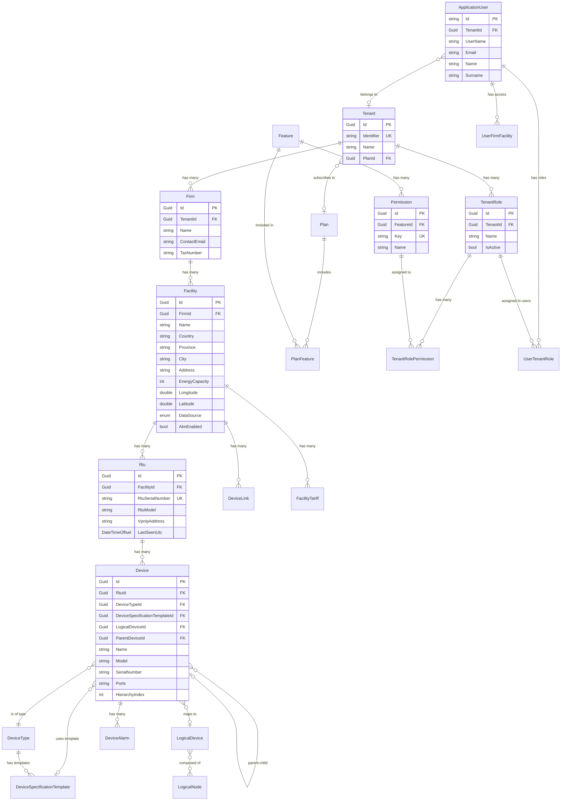

---

## 2. Entity Dependency Graph

Shows what must exist before each entity can be created.

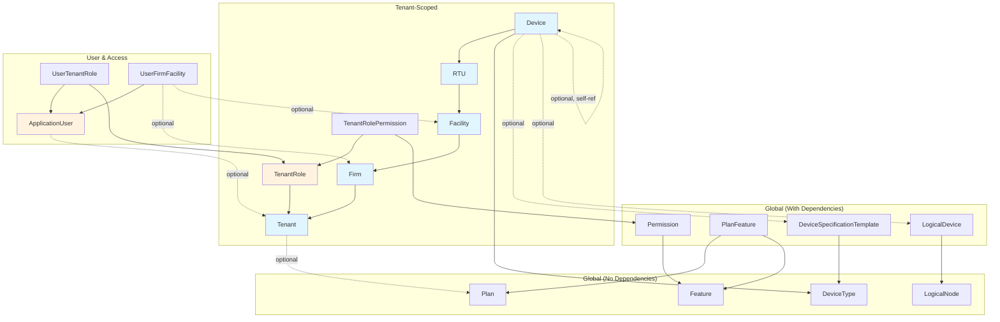

### Required Creation Order

| Step | Entity | Required Dependencies |
|------|--------|----------------------|
| 1 | Plan, Feature, DeviceType, LogicalNode | None (global seed data) |
| 2 | Permission | Feature |
| 3 | PlanFeature | Plan + Feature |
| 4 | LogicalDevice | LogicalNode(s) |
| 5 | DeviceSpecificationTemplate | DeviceType |
| 6 | **Tenant** | None (optionally Plan) |
| 7 | Firm | Tenant |
| 8 | TenantRole | Tenant |
| 9 | TenantRolePermission | TenantRole + Permission |
| 10 | **Facility** | Firm |
| 11 | **RTU** | Facility |
| 12 | **Device** | RTU + DeviceType |
| 13 | **ApplicationUser** | None (optionally Tenant) |
| 14 | UserTenantRole | User + TenantRole |
| 15 | UserFirmFacility | User + Tenant (+ optional Firm/Facility) |

---

## 3. Process 1: Adding a New Site (Facility)

### Prerequisites

A **Facility** cannot be created in isolation. The following must exist first:

1. **Tenant** — the multi-tenant root
2. **Firm** — a company under the tenant (Facility belongs to a Firm)

### Data Constraints

| Field | Required | Notes |
|-------|----------|-------|
| FirmId | Yes | FK to existing Firm |
| Name | Yes | max 500 chars |
| Country | Yes | Full country name (e.g., "Türkiye") |
| Province | Yes | Province/state code |
| City | Yes | City name |
| Address | Yes | Physical address, max 1000 chars |
| EnergyCapacity | Yes | Integer capacity value |
| EnergyUnit | Yes | Enum: KWh (default), MWh, etc. |
| Longitude | Yes | GPS coordinate |
| Latitude | Yes | GPS coordinate |
| DataSource | No | Default: Rtu (0). Alternative: Huawei (1) |
| AlmEnabled | No | Default: false |

### Sequence Diagram

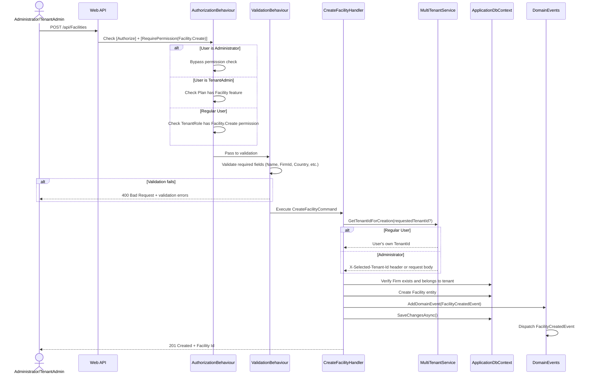

### What a Facility Can Exist Without

- RTUs and Devices (empty site is valid)
- Tariffs (can be assigned later)
- ALM predictions (opt-in)
- Topology JSON (optional layout)

### What Cannot Exist Without a Facility

- RTU (requires FacilityId)
- DeviceLink (requires FacilityId)
- FacilityTariff (requires FacilityId)

---

## 4. Process 2: Adding a New Device

### Prerequisites

A **Device** has the deepest dependency chain in the system:

```
Tenant → Firm → Facility → RTU → Device
```

ALL of these must exist before a device can be created. Additionally:
- **DeviceType** must exist (e.g., "EnergyStorage", "PCS", "Solar Panel")
- **DeviceSpecificationTemplate** (optional but recommended for composite devices)
- **LogicalDevice** (optional, IEC 61850 catalog reference)

### Three Device Creation Methods

#### Method 1: Direct Creation (`CreateDeviceCommand`)

Simple single-device creation.

| Field | Required | Notes |
|-------|----------|-------|
| RtuId | Yes | FK to existing RTU |
| DeviceTypeId | Yes | FK to existing DeviceType |
| Name | Yes | max 100 chars |
| Model | Yes | max 200 chars |
| SerialNumber | No | max 100 chars |
| Manufacturer | No | max 200 chars |
| Ports | No | JSON array, default "[]" |
| ParentDeviceId | No | FK to parent Device for hierarchy |
| DeviceSpecificationTemplateId | No | FK to template |
| LogicalDeviceId | No | FK to logical device catalog |
| Metadata | No | JSON blob |

#### Method 2: Composite Registration (`RegisterDeviceCompositeCommand`)

Creates a parent device with its entire child hierarchy from a template.

| Field | Required | Notes |
|-------|----------|-------|
| RtuId | Yes | FK to existing RTU |
| DeviceSpecificationTemplateId | Yes | Must have HierarchyTemplate |
| Name | Yes | Parent device name |
| SerialNumber | No | Parent serial number |

#### Method 3: Logical Device Registration (`RegisterDeviceFromLogicalDevice`)

Creates a device from the IEC 61850 LogicalDevice catalog.

| Field | Required | Notes |
|-------|----------|-------|
| RtuId | Yes | FK to existing RTU |
| LogicalDeviceId | Yes | FK to LogicalDevice with HierarchyTemplate |
| Name | Yes | Parent device name |

### Sequence Diagram — Composite Device Registration

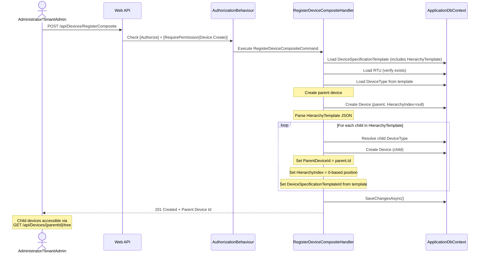

### Device Hierarchy Example (BESS Container)

```
Container (DeviceType: EnergyStorage)
  ├── Rack 1 (DeviceType: EnergyStorage, HierarchyIndex: 0)
  ├── Rack 2 (DeviceType: EnergyStorage, HierarchyIndex: 1)
  ├── PCS 1 (DeviceType: PCS, HierarchyIndex: 0)
  ├── Chiller 1 (DeviceType: Chiller, HierarchyIndex: 0)
  └── Smart Meter (DeviceType: SmartMeter, HierarchyIndex: 0)
```

### What a Device Can Exist Without

- Child devices (leaf device is valid)
- DeviceSpecificationTemplate (standalone device)
- LogicalDevice (legacy path)
- Telemetry data (device exists before data arrives)
- Alarms (created dynamically from telemetry)

### What Cannot Exist Without a Device

- DeviceAlarm (requires DeviceId)
- Child Device (requires ParentDeviceId)
- DeviceBatteryData/DevicePcsData/DeviceSolarData/DeviceSmartMeterData (require DeviceId + RtuId)

---

## 5. Process 3: Adding a New User

### Prerequisites

- **Tenant** must exist if the user will be scoped to a tenant
- System administrators can exist without a tenant (TenantId = null)

### User Creation Flow

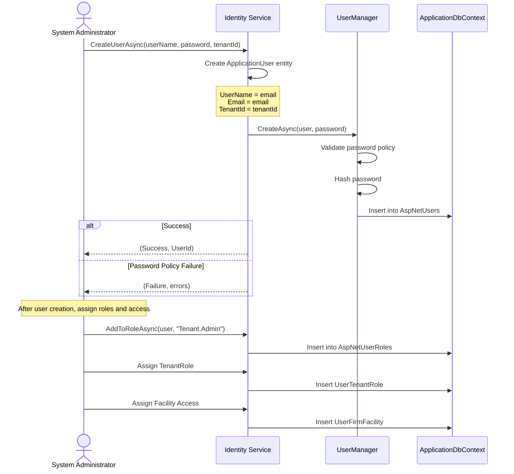

### Post-Creation Setup Required

After creating a user, the following must be configured for the user to be functional:

| Step | Entity | Purpose | Required? |
|------|--------|---------|-----------|
| 1 | Identity Role | Base role (Administrator, Tenant.Admin, User, etc.) | Yes |
| 2 | TenantRole → UserTenantRole | Feature-based permissions | Yes (for non-admins) |
| 3 | UserFirmFacility | Granular Firm/Facility access | Depends on role |

### User Types and Their Access Patterns

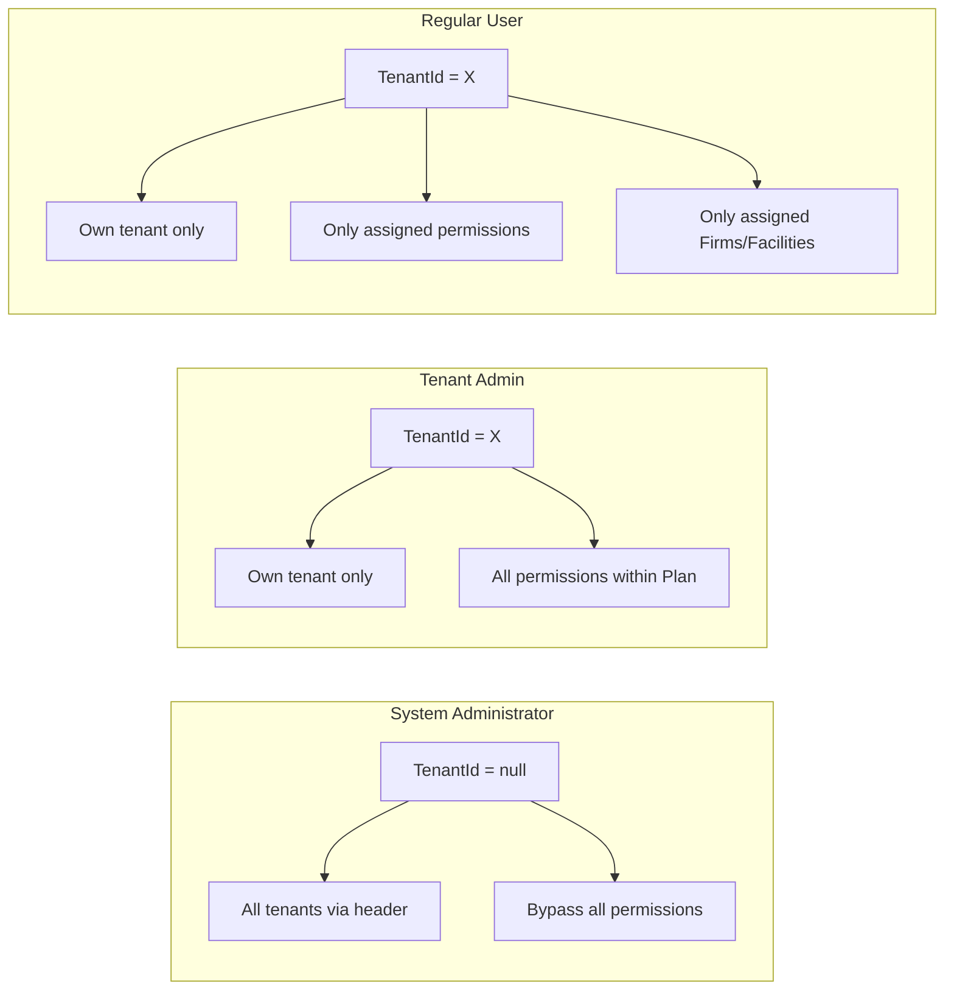

---

## 6. Process 4: Authorization Change

Authorization changes involve modifying a user's access level. There are multiple layers:

### Layer 1: Identity Role Change

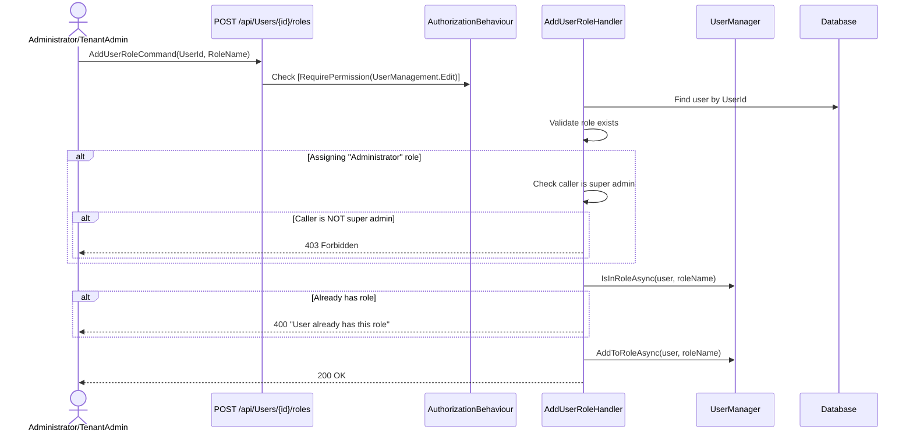

### Layer 2: Permission Role Change (TenantRole Assignment)

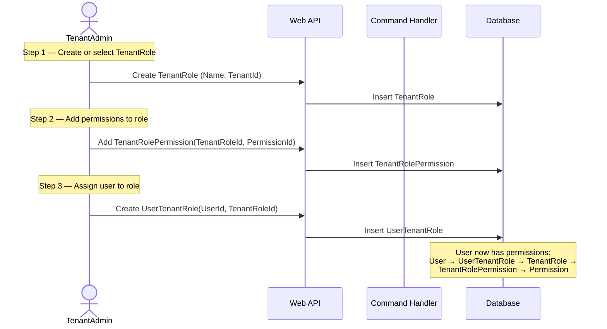

### Layer 3: Facility Access Change

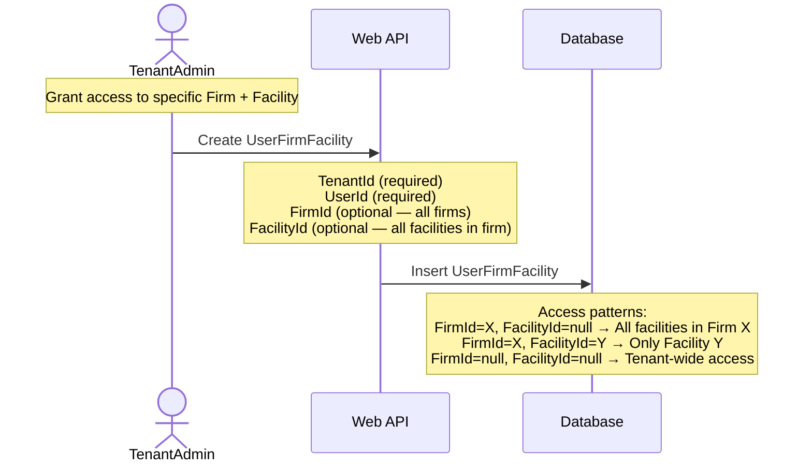

### Authorization Check Flow (Runtime)

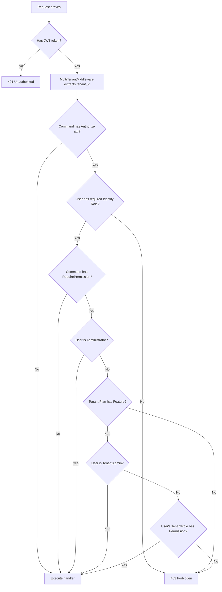

---

## 7. Process 5: Authorization Removal

### Removing an Identity Role

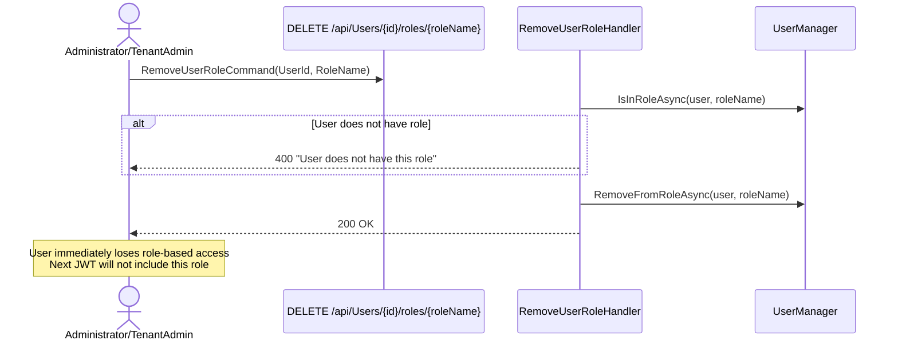

### Removing Permission-Based Access

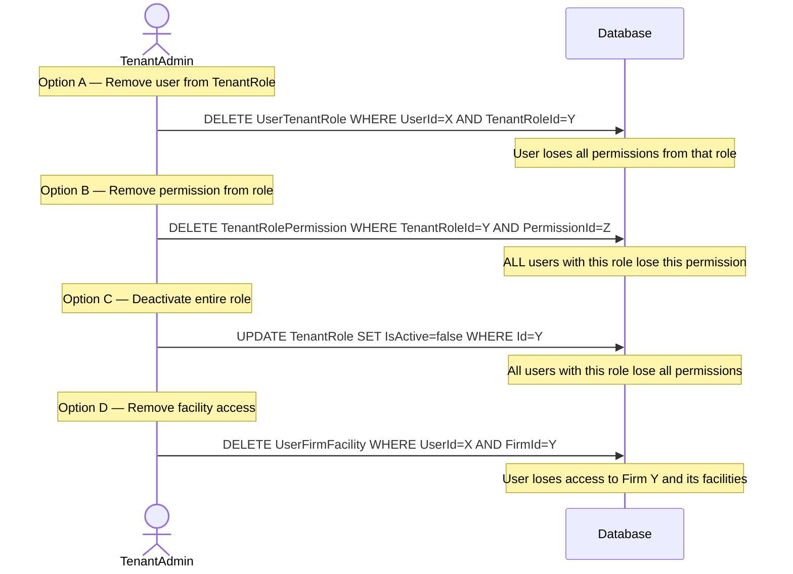

### Cascade Effects of Authorization Removal

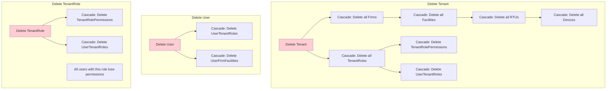

---

## 8. BESS Hierarchy — Deep Dive

### Overview

When a user navigates to **Battery > Battery Package** and opens the **Hierarchy** tab, the frontend calls:

```
GET /api/v1/BatteryStorage/Tree/{facilityId}
```

This returns a recursive tree of all BESS devices in that facility. Clicking any node calls:

```
GET /api/v1/BatteryStorage/Units/{unitId}/Header
```

Which returns level-aware header data (breadcrumbs, telemetry, available tabs).

### Physical Hierarchy Structure (Ottomotive Reference)

The Ottomotive BESS Container is the reference device. Its hierarchy:

```
┌─────────────────────────────────────────────────────────────────┐
│  BESS Container (DeviceType: EnergyStorage)                     │
│  ├── Rack 1  (DeviceType: EnergyStorage.Rack, HierarchyIndex: 0)│
│  ├── Rack 2  (DeviceType: EnergyStorage.Rack, HierarchyIndex: 1)│
│  ├── ...                                                         │
│  ├── Rack 12 (DeviceType: EnergyStorage.Rack, HierarchyIndex: 11)│
│  ├── PCS_001 (DeviceType: PCS,                HierarchyIndex: 0)│
│  └── HVAC_001(DeviceType: EnergyStorage.TMS,  HierarchyIndex: 0)│
└─────────────────────────────────────────────────────────────────┘
```

The **LogicalDevice** model defines deeper nesting (IEC 61850-inspired):

```
BatteryContainer
  └── BatteryRack (×4 default)
        └── BatteryPack (×8 per rack)
              └── (leaf — no further children)
```

### Full DeviceType Hierarchy

```
DeviceTypeNames (Domain/Constants/DeviceTypeNames.cs)
├── EnergyStorage              → display: "unit"     (root container)
├── EnergyStorage.Rack         → display: "rack"
├── EnergyStorage.Pack         → display: "pack"
├── EnergyStorage.Module       → display: "module"
├── EnergyStorage.Battery      → display: "battery"  (cell-level)
├── EnergyStorage.Controller   → display: "esc"      (energy storage controller)
├── EnergyStorage.TMS          → display: "hvac"     (thermal management)
├── PCS                        → display: "pcs"
├── Solar                      → display: "solar"
└── Smart Meter                → display: "meter"
```

### How the Tree is Built (Backend Flow)

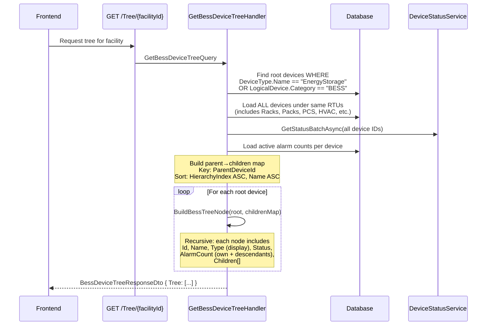

### Display Type Mapping (`BessDisplayTypeMapper`)

The mapper at `GetBessDeviceTree.cs:120-136` converts DeviceType names to frontend display types:

| DeviceType Name | Display Type | Tree Icon | Notes |
|----------------|-------------|-----------|-------|
| `EnergyStorage` | `unit` | Container | Root level, has all tabs |
| `EnergyStorage.Rack` | `rack` | Rack | Sub-unit, summary + alarms tabs |
| `EnergyStorage.Pack` | `pack` | Pack | Sub-unit, summary + alarms tabs |
| `EnergyStorage.Module` | `module` | Module | Has **cells** tab |
| `EnergyStorage.Battery` | `battery` | Cell | Leaf level |
| `EnergyStorage.Controller` | `esc` | Controller | Settings + alarms tabs only |
| `EnergyStorage.TMS` | `hvac` | HVAC | Settings + alarms tabs only |
| `PCS` | `pcs` | Inverter | Shown in connectedDevices, not tree |
| Unknown type | `null` | — | **Filtered out of tree** |

### Level-Aware Header (`GetBessUnitHeader`)

When a user clicks any node in the hierarchy, the header endpoint returns level-specific data:

```mermaid
flowchart TD
    A[GET /Units/{unitId}/Header] --> B{What display type?}

    B -->|"unit"| C[Root Container Header]
    C --> C1[SoC, SoH, Power, Voltage, Current]
    C --> C2[Operating Mode badge]
    C --> C3[Connected Devices: PCS, HVAC, ESC]
    C --> C4[Tabs: Summary, Health, Curves,<br/>Hierarchy, FaultFlags, Faults]

    B -->|"rack" / "pack"| D[Sub-Unit Header]
    D --> D1[Walks UP parent chain to find:<br/>UnitId/Name, RackId/Name, PackId/Name]
    D --> D2[Inherits telemetry from root container]
    D --> D3[Tabs: Summary, Alarms]

    B -->|"module"| E[Module Header]
    E --> E1[Same as sub-unit]
    E --> E2[Tabs: Summary, **Cells**, Alarms]

    B -->|"hvac"| F[HVAC Sections Header]
    F --> F1[Device Info section]
    F --> F2[Chiller State: coolant temps, compressor,<br/>pump, fan, heater statuses]
    F --> F3[Setpoints section]
    F --> F4[Tabs: Settings, Alarms]

    B -->|"esc"| G[ESC Sections Header]
    G --> G1[Device Info section]
    G --> G2[Live Data: DC voltages, current,<br/>power, efficiency, temp]
    G --> G3[Tabs: Settings, Alarms]
```

### Breadcrumb Resolution (Parent Chain Walk)

For any non-root node, the handler walks up the `ParentDeviceId` chain to build breadcrumbs:

```
User clicks "Pack 3" inside "Rack 2" inside "Container A"

Header response includes:
  UnitId:   Container_A.Id    UnitName:   "Container A"
  RackId:   Rack_2.Id         RackName:   "Rack 2"
  PackId:   null               PackName:   null        (current level, not ancestor)
  HierarchyNumber: 3          (HierarchyIndex + 1)

Frontend renders: Container A > Rack 2 > Pack 3
```

Code path (`GetBessUnitHeader.cs:70-95`):
```csharp
// Walk UP parent chain
while (ancestor.ParentDeviceId.HasValue)
{
    var parentType = MapToDisplayType(parent.DeviceType?.Name);
    switch (parentType)
    {
        case "unit": unitId = parent.Id; unitName = parent.Name; break;
        case "rack": rackId = parent.Id; rackName = parent.Name; break;
        case "pack": packId = parent.Id; packName = parent.Name; break;
    }
    ancestor = parent;
}
```

### Telemetry Resolution for Hierarchy Levels

**Critical concept:** Telemetry data (SoC, voltage, current, etc.) is typically ingested at the **root container** level. Sub-devices (Rack, Pack, Module) don't receive their own telemetry from EMQX — they inherit from the root.

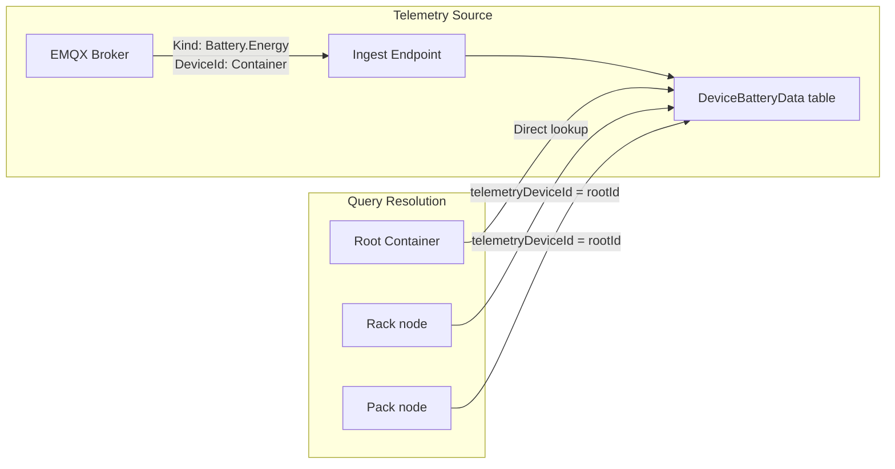

In `GetBessUnitHeader.cs:140-142`:
```csharp
// For sub-devices, telemetry is stored under the root container
var telemetryDeviceId = !isRootUnit && unitId.HasValue
    ? unitId.Value   // ← uses ROOT device's telemetry
    : device.Id;
```

### Parameter Resolution & Derivation

The **ParameterResolver** provides computed values when telemetry doesn't directly supply them.

#### Ottomotive BESS — 23 Parameters (Seed Data)

| Parameter | Type | Source / Formula | Notes |
|-----------|------|-----------------|-------|
| `soc` | Source | `Battery.Energy → soc` | Direct from telemetry |
| `soh` | Source | `Battery.Soh → soh` | Direct from telemetry |
| `voltage` | Source | `Battery.Energy → voltage` | Direct (V) |
| `current` | Source | `Battery.Energy → current` | Direct (A) |
| **`power`** | **Formula** | `round(multiply(voltage, current, 0.001), 1)` | **Derived: V × A / 1000 = kW** |
| **`powerDirection`** | **Formula** | `cond(lt(current, 0), 'discharging', cond(gt(current, 0), 'charging', 'idle'))` | **Derived from current sign** |
| `operatingMode` | Source | `Battery.Status → state` | Direct |
| `cellVoltageMax` | Source | `Battery.Energy → cellMaxVoltage` | Direct (V) |
| `cellVoltageMin` | Source | `Battery.Energy → cellMinVoltage` | Direct (V) |
| `cellVoltageAvg` | Source | `Battery.Energy → cellAvgVoltage` | Direct (V) |
| **`voltageSpread`** | **Formula** | `subtract(cellVoltageMax, cellVoltageMin)` | **Derived: max - min** |
| `tempMax` | Source | `Battery.Energy → maxTemp` | Direct (°C) |
| `tempMin` | Source | `Battery.Energy → minTemp` | Direct (°C) |
| **`tempAvg`** | **Formula** | `round(avg(tempMin, tempMax), 1)` | **Derived: average** |
| `tempAmbient` | Source | `Battery.Energy → ambientTemp` | Direct (°C) |
| `cycles` | Source | `Battery.Health → cycleCount` | Direct |
| **`cycleLifePct`** | **Formula** | `round(multiply(divide(cycles, 6000), 100), 1)` | **Derived: cycles/designedLife × 100** |
| `availableEnergy` | Source | `Battery.Energy → availableEnergy` | Direct (kWh) |
| `pcsActivePower` | Source | `Pcs.PowerDistribution → totalActivePower` | From child PCS device |
| `pcsReactivePower` | Source | `Pcs.PowerDistribution → totalReactivePower` | From child PCS device |
| `pcsDcPower` | Source | `Pcs.DcMeasurement → dcPower` | From child PCS device |
| `pcsEfficiency` | Source | `Pcs.AcMeasurement → efficiency` | From child PCS device |
| `gridFrequency` | Source | `Pcs.AcMeasurement → gridFrequency` | From child PCS device |

#### Derivation Flow

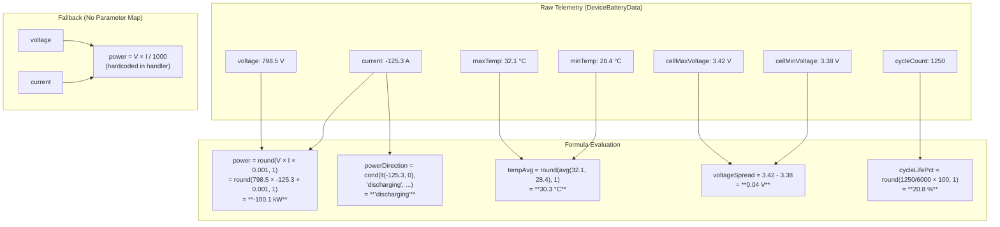

### Devices That Don't Provide Hierarchy Info

For devices **without a `DeviceSpecificationTemplate`** or **without a `ParameterMapTemplate`**, the system uses a 3-tier fallback:

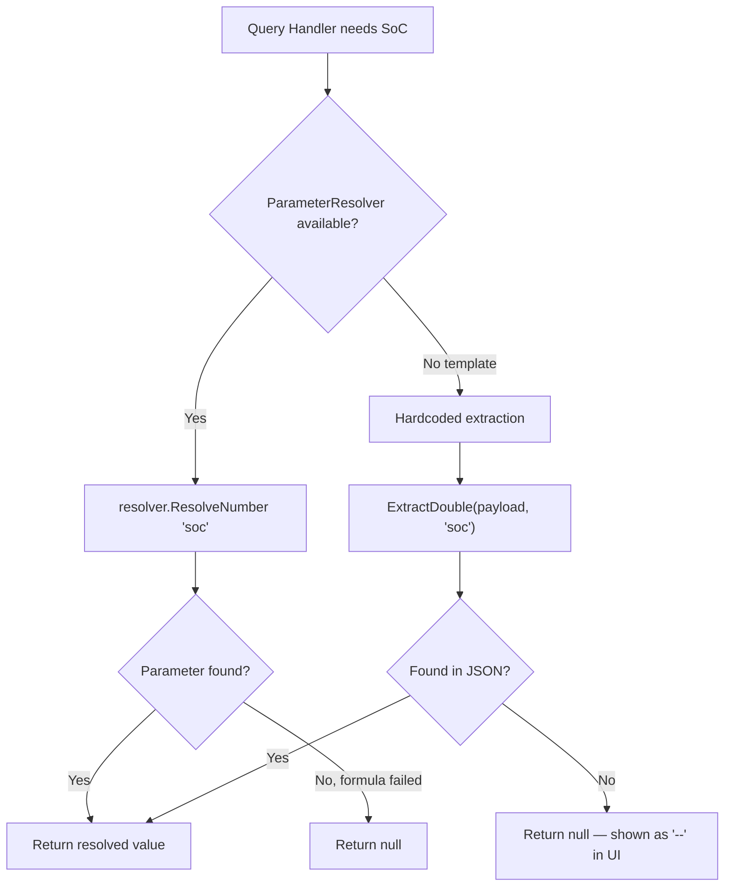

#### Specific Fallback Patterns in GetBessUnits/GetBessUnitHeader:

```csharp
// Pattern: resolver first ?? hardcoded fallback
Soc  = resolver?.ResolveNumber(ParameterKeys.Soc)
       ?? ExtractDouble(battPayload, "soc");

Power = resolver?.ResolveNumber(ParameterKeys.Power)
        ?? (voltage * current / 1000.0);  // manual derivation

Soh  = resolver?.ResolveNumber(ParameterKeys.Soh)
       ?? ExtractDouble(battPayload, "soh");
```

### Hierarchy Creation (How it Gets Built)

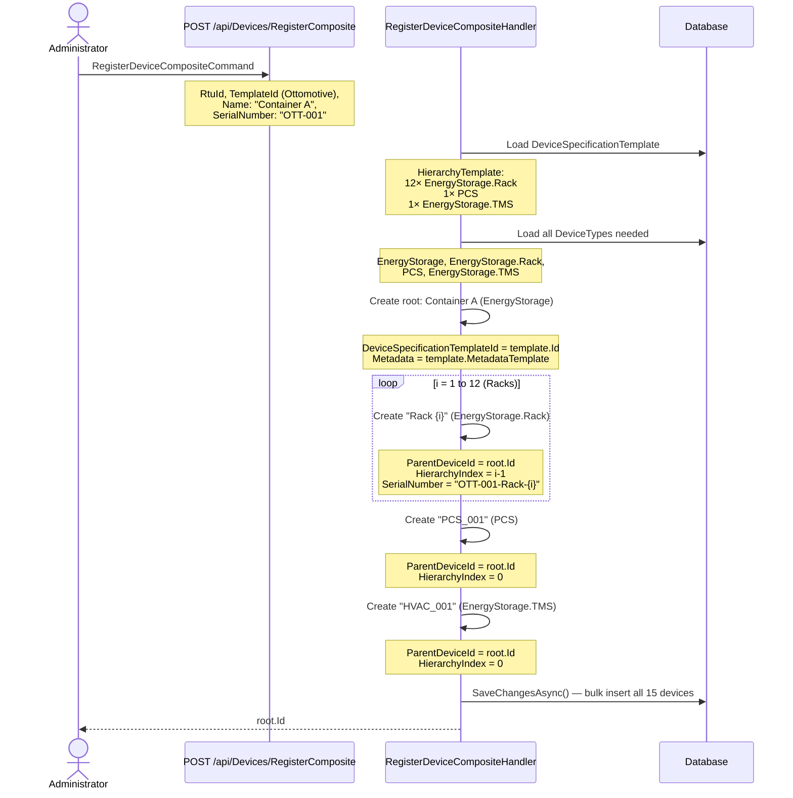

### Available Tabs per Hierarchy Level

| Level | Tabs | Data Source |
|-------|------|-------------|
| **unit** (root) | Summary, Health, Curves, Hierarchy, FaultFlags, Faults | Own telemetry + child PCS |
| **rack** | Summary, Alarms | Inherited from root container |
| **pack** | Summary, Alarms | Inherited from root container |
| **module** | Summary, **Cells**, Alarms | Inherited from root container |
| **battery** | Summary, Alarms | Inherited from root container |
| **esc** | Settings, Alarms | Sections-based (device info + live data) |
| **hvac** | Settings, Alarms | Sections-based (chiller state + setpoints) |

### Connected Devices (Non-Hierarchy Siblings)

At the root level, the header also returns **connectedDevices** — child devices that are NOT part of the battery hierarchy (PCS, HVAC, ESC):

```json
{
  "connectedDevices": {
    "pcs": [{ "id": "...", "name": "PCS_001" }],
    "hvac": [{ "id": "...", "name": "HVAC_001" }]
  }
}
```

These are filtered OUT of the main tree (`rack`, `pack`, `module`, `battery` types stay in tree), but shown as sidebar links in the UI.

### JSON Example: Tree Response

```json
{
  "tree": [
    {
      "id": "container-guid",
      "name": "Container A",
      "type": "unit",
      "status": "normal",
      "parentDeviceId": null,
      "alarmCount": 3,
      "children": [
        {
          "id": "rack-1-guid",
          "name": "Rack 1",
          "type": "rack",
          "status": "normal",
          "parentDeviceId": "container-guid",
          "alarmCount": 1,
          "children": []
        },
        {
          "id": "rack-2-guid",
          "name": "Rack 2",
          "type": "rack",
          "status": "warning",
          "parentDeviceId": "container-guid",
          "alarmCount": 2,
          "children": []
        }
      ]
    }
  ]
}
```

> **Note:** In the Ottomotive template, Racks have no children defined in `HierarchyTemplate`. The LogicalDevice model (BatteryRack → BatteryPack nesting) supports deeper hierarchy but is not yet wired into the Ottomotive seed data. To get Pack/Module levels, either:
> 1. Add nested `children` to the Ottomotive `HierarchyTemplate`, or
> 2. Use `RegisterDeviceFromLogicalDevice` which follows `LogicalDevice.HierarchyTemplate` recursively.

---

## 9. Creation Order Summary

### Minimum Steps to Set Up a Fully Functional Site with Users

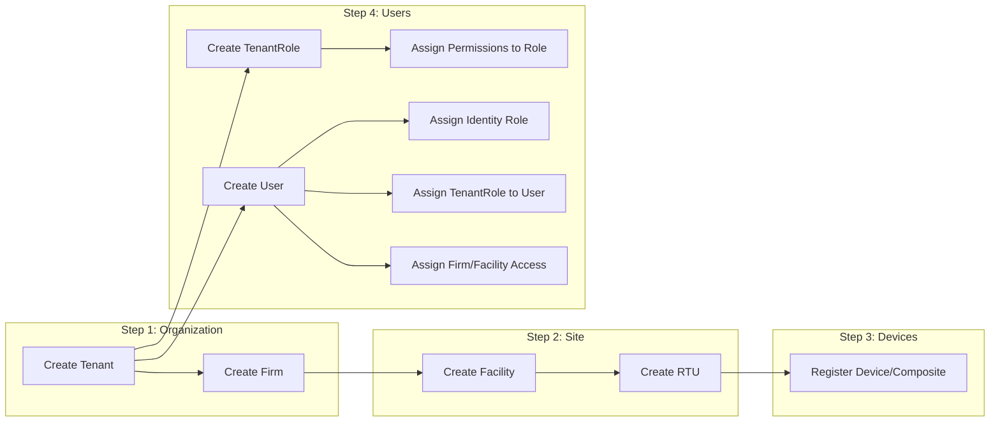

### Cannot Create Without

| Entity | Requires |
|--------|----------|
| Firm | Tenant |
| Facility | Firm (→ Tenant) |
| RTU | Facility (→ Firm → Tenant) |
| Device | RTU + DeviceType (→ Facility → Firm → Tenant) |
| TenantRole | Tenant |
| TenantRolePermission | TenantRole + Permission (→ Feature) |
| UserTenantRole | User + TenantRole |
| UserFirmFacility | User + Tenant |

### Can Create Independently

| Entity | Notes |
|--------|-------|
| Tenant | Top-level, no dependencies |
| Plan | Global subscription tier |
| Feature | Global feature module |
| DeviceType | Global device catalog |
| LogicalDevice/Node | IEC 61850 catalog |
| ApplicationUser | Can exist without tenant (admin) |

---

## 10. Cascade Delete Behavior

| Deleting... | Cascades To | Blocked By |
|-------------|-------------|------------|
| Tenant | Firms, TenantRoles | — |
| Firm | Facilities | — |
| Facility | RTUs, DeviceLinks, FacilityTariffs | — |
| RTU | Devices | — |
| Device | Alarms | Child Devices (Restrict) |
| DeviceType | — | Devices using it (Restrict) |
| LogicalDevice | — | Devices using it (Restrict) |
| DeviceSpecTemplate | Devices set FK to null (SetNull) | — |
| Feature | Permissions, PlanFeatures | — |
| Permission | TenantRolePermissions | — |
| Plan | PlanFeatures | — |
| TenantRole | TenantRolePermissions, UserTenantRoles | — |
| User | UserTenantRoles, UserFirmFacilities | — |

**Key Restriction:** You cannot delete a parent Device if it still has child devices. You must delete children first (bottom-up).
