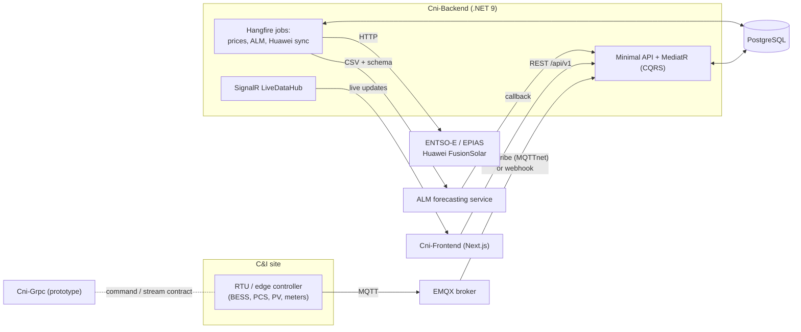

# Commercial and Industrial Energy Management System (C&I EMS)

A multi-tenant platform for monitoring and operating energy assets at commercial and industrial (C&I) sites: battery energy storage systems (BESS), power conversion systems (PCS), solar inverters, and smart meters. It also integrates day-ahead energy prices and tariffs, and AI-based consumption and generation forecasting.

This monorepo brings together three projects that were previously kept in separate repositories:

| Folder | What it is | Stack |
|---|---|---|
| [`Cni-Backend/`](Cni-Backend/) | REST API, telemetry ingestion, background jobs (formerly **DERMS Backend**) | .NET 9, ASP.NET Core Minimal APIs, EF Core, PostgreSQL |
| [`Cni-Frontend/`](Cni-Frontend/) | Operator dashboard and configuration UI | Next.js 16, React 19, Tailwind CSS 4, shadcn/ui |
| [`Cni-Grpc/`](Cni-Grpc/) | gRPC prototype of the site-controller (EMS edge) contract | .NET 8, Grpc.AspNetCore |

## Overview

The system models the organization as **Tenant → Firm → Facility → RTU → Device**. On top of that model it provides:

- **Facilities and devices**: facility registry with location data, remote terminal units (RTUs), and hierarchical device trees (container → BESS → racks/modules, PCS, chillers, meters).
- **Battery storage (BESS) and PCS monitoring**: summary, units, health, curves, and fault flags, built from time-series telemetry.
- **Solar inverters**: inverter monitoring endpoints and UI (power, curves, faults).
- **Alarms and maintenance**: an alarm catalog per device model, automatic raise and recovery from fault flags, alarm statistics and history, and maintenance tasks created from alarms.
- **Energy prices and market operators**: day-ahead prices from ENTSO-E (EU) and EPIAS (Turkey), country tariff configuration, and a gross-price formula (net price plus distribution fees and taxes).
- **ALM integration**: the backend sends facility data to an external Algorithm Module, which returns power consumption and power generation forecasts asynchronously.
- **Huawei FusionSolar integration**: polls FusionSolar stations and translates the results into the platform's standard telemetry format.
- **Security and multi-tenancy**: JWT authentication with refresh-token rotation, role-based and plan/feature-based permissions, tenant isolation through EF Core query filters, and admin tenant impersonation.
- **Real-time and observability**: SignalR live data hub, Hangfire dashboard, and Prometheus metrics for HTTP, database, MQTT and ALM.

## Architecture



## Projects

### Cni-Backend

**Purpose:** the system of record and integration hub. It ingests device telemetry and alarms, exposes the REST API used by the frontend, and runs the scheduled integrations.

**Stack:** .NET 9 (`global.json`), Clean Architecture (`Domain`, `Application`, `Infrastructure`, `Web`), MediatR CQRS, FluentValidation, AutoMapper, EF Core 9 with Npgsql/PostgreSQL, ASP.NET Identity + JWT, Hangfire (PostgreSQL storage), MQTTnet, SignalR, Serilog, prometheus-net, NSwag. Tests use NUnit 4, FluentAssertions, Moq, and SQLite in-memory. NuGet versions are managed centrally in `Directory.Packages.props`. Warnings are treated as errors.

**Key features:**
- Telemetry ingestion from EMQX (`cni/{facilityId}/{rtuId}/{channel}` topics) through an MQTT worker, plus API-key-protected HTTP ingest endpoints. Payloads are categorized into Battery, PCS, Solar, and SmartMeter tables (JSONB payloads with `long` IDs for high volume).
- Device catalog: specification templates, an IEC 61850-inspired `LogicalDevice`/`LogicalNode` model, composite device registration, and virtual hierarchy levels.
- **Parameter mapper:** per-template JSON parameter maps with a small formula evaluator, so dashboards resolve values such as SoC, SoH, power, and temperatures without hard-coded field names.
- Endpoint groups: Auth, Tenants, Firms, Facilities, Devices, BatteryStorage, Pcs, SolarInverters, Alarms, Maintenance, Notifications, Dashboard, Graphs, Scada, EnergyPrices, MarketOperators, Plans, Permissions, TenantRoles, Users, Huawei, Alm.
- Background jobs: `EnergyPriceFetchWorker` (twice daily), `AlmPredictionWorker` (daily, cron-configurable), `HuaweiFusionSolarSyncWorker` (every 5 minutes), `MqttIngestionWorker`.
- Packaging: multi-stage Dockerfile (port 8080, `/health`), with Jenkins and Azure pipeline definitions.

**Run locally** (requires the .NET 9 SDK and a PostgreSQL instance):

```bash
cd Cni-Backend
dotnet build -tl
# supply secrets first (see Configuration below)
dotnet ef database update --project src/Infrastructure --startup-project src/Web
cd src/Web && dotnet watch run          # https://localhost:5001
dotnet test --filter "UnitTests"        # unit tests (what CI runs)
```

Detailed design notes are in [`Cni-Backend/docs/`](Cni-Backend/docs/): architecture and data flow, authentication, MQTT topic structure, message packages, BESS hierarchy, logical device model, tariffs and energy prices, ALM integration, Huawei integration, and per-feature API references.

### Cni-Frontend

**Purpose:** the web UI for operators and administrators.

**Stack:** Next.js 16 (App Router, standalone output), React 19, TypeScript (strict), Tailwind CSS 4, shadcn/ui (new-york), recharts, react-hook-form + zod, date-fns, lucide-react, sonner.

**Key features:**
- Dashboards with energy-flow and statistics charts, monitoring, and a SCADA view (including an isometric BESS visualization).
- BESS hierarchy, unit and cell detail; PCS monitoring; solar inverter tables, detail, fault, and curve tabs.
- Alarms (filters, detail panel), maintenance tasks (assign, complete, paginated), notifications.
- Financials view for energy prices.
- Administration: tenants/holdings, facilities, facility map, devices, users, roles and permissions, plans, SMTP configuration, blocked addresses, capacity limits, and operating modes.
- Authentication aligned with the backend (login, forgot and reset password, protected routes).
- A shared design system with separate energy-domain and severity/status color tokens (light and dark).

**Run locally** (requires Node.js 20+):

```bash
cd Cni-Frontend
npm install
# create .env.local, e.g. NEXT_PUBLIC_API_BASE_URL=/api/v1
npm run dev      # http://localhost:3000
npm run build && npm run start
```

In development, API calls are proxied to the backend through Next.js rewrites in `next.config.ts`. Point the rewrite at your own backend, for example `https://localhost:5001`. More detail is in [`Cni-Frontend/docs/`](Cni-Frontend/docs/), which covers architecture, API services, authentication, features and permissions, configuration pages, the color system, and mock data.

### Cni-Grpc

**Purpose:** a prototype of the gRPC contract between the EMS and an on-site controller. It was explored before the backend standardized on MQTT. gRPC was later removed from `Cni-Backend`, and this project is kept as a reference.

**Stack:** .NET 8, `Grpc.AspNetCore` (server), `Grpc.Net.Client` + `Google.Protobuf` (client), `Grpc.Tools`.

**Key features:**
- Proto definitions under `GrpcServer/Protos/`: system commands (`SystemPowerService`, `QuerySystemInfoService`, `SystemSetupService` for BESS mode and active, reactive, and charge power setpoints), system events, and server-streaming telemetry for BESS, PCS, solar, smart meter, generator, and system.
- Stream services replay sample JSON data (`GrpcServer/GrpcJsonValues/`).
- A console client that demonstrates unary and server-streaming calls.

**Run locally:**

```bash
cd Cni-Grpc
dotnet run --project GrpcServer     # https://localhost:7129
dotnet run --project GrpcClient     # in a second terminal
```

## Development history

The backend started as the **DERMS Backend**, generated from the Clean Architecture solution template. It was later renamed **Cni-Backend**. The milestones below are reconstructed from the Claude Code session history, project memory, and git history:

- **Foundation (Jan to Feb 2026):** fixed package version and AutoMapper conflicts, and migrated from MSSQL to PostgreSQL (SQLite for tests). Added CLAUDE.md, admin user seeding with a demo hierarchy, multi-tenant RBAC (plans, features, permissions, tenant roles), and the two-level `[Authorize]` / `[RequirePermission]` pipeline.
- **Energy prices:** ENTSO-E XML parsing (time-resolution and timezone fixes), EPIAS integration, and a country tariff configuration with a gross-price formula.
- **Device model and telemetry (Feb 2026):** device data ingestion and categorization, specification templates, composite registration, and the `Battery` to `EnergyStorage` rename. Added container telemetry loading, virtual hierarchy levels, the alarm catalog with automatic alarm processing, the parameter mapper and formula evaluator (with unit tests), and BESS/PCS endpoints rewritten to match the frontend contract.
- **Logical devices, alarms and maintenance (Mar 2026):** IEC 61850-inspired LogicalDevice/LogicalNode catalog. Alarm management decoupled from telemetry with a dedicated ingestion endpoint, a Maintenance subdomain, and notifications.
- **Integrations (Mar 2026):** Huawei FusionSolar sync, an EMQX direct-subscribe MQTT worker (gRPC/Protobuf removed from the backend), Prometheus/Grafana metrics, and ALM forecasting (power consumption and generation, callback endpoint, daily worker, manual trigger).
- **Latest work:** facility country, province and city fields; a demo tenant seed; process-flow and message-package documentation; and the Solar Inverters endpoint group with its API docs. On the frontend: user, role and permission management, backend-aligned authentication, PCS monitoring integration, maintenance pagination, and system documentation.
- **Oct 2026:** the three repositories were consolidated into this monorepo.

**Planned or deferred:** device status tracking (online/standby/offline from telemetry freshness), computed metrics and a health page, Redis caching, IEC 61850 ingestion parsing, and wider use of the parameter mapper.

## Repository layout

```
.
├── Cni-Backend/
│   ├── src/{Domain,Application,Infrastructure,Web}/
│   ├── tests/{Domain.UnitTests,Application.UnitTests,Application.FunctionalTests,Infrastructure.IntegrationTests}/
│   ├── docs/            # design notes and API references
│   ├── scripts/ infra/  # SQL helpers, infrastructure definitions
│   ├── Cni-Backend.sln  Directory.Build.props  Directory.Packages.props
│   └── Dockerfile  Jenkinsfile  azure-pipelines.yml
├── Cni-Frontend/
│   ├── app/             # App Router pages (main, configuration, alarms, maintenance, ...)
│   ├── components/      # ui/, dashboard/, bess/, solar-inverters/, alarms/, ...
│   ├── lib/  hooks/  public/  docs/
│   └── package.json  next.config.ts  Dockerfile  Jenkinsfile
└── Cni-Grpc/
    ├── GrpcServer/      # proto contracts + stream/command services
    ├── GrpcClient/      # demo console client
    └── GrpcDemo.sln
```

## Configuration and secrets

**Secrets were removed from this repository's git history.** Configuration values such as connection strings, JWT signing keys, API keys, MQTT, SMTP, and third-party credentials now appear as `***REMOVED***` in `appsettings*.json` and similar files. The application will not start with these placeholder values. Supply real values locally through one of:

- **.NET user-secrets** (development):
  ```bash
  cd Cni-Backend/src/Web
  dotnet user-secrets set "ConnectionStrings:BackendDb" "<your-connection-string>"
  dotnet user-secrets set "JwtSettings:Secret" "<random-32+-char-secret>"
  ```
- **Environment variables**, using `__` as the section separator, for example `ConnectionStrings__BackendDb`, `JwtSettings__Secret`, `IngestSettings__ApiKey`, `AlmSettings__ApiKey`, `HuaweiSettings__EncryptionKey`, `EmailSettings__Password`.
- **Azure Key Vault**: set `AZURE_KEY_VAULT_ENDPOINT` and the backend loads secrets from the vault.
- **Frontend**: `.env.local` (not committed), for example `NEXT_PUBLIC_API_BASE_URL`, plus server-side FusionSolar variables if used.

Never commit real credentials, hostnames of private infrastructure, or seeded passwords. Seeded development accounts should be configured locally and changed before any shared deployment.

## License

Released under the [MIT License](LICENSE).
